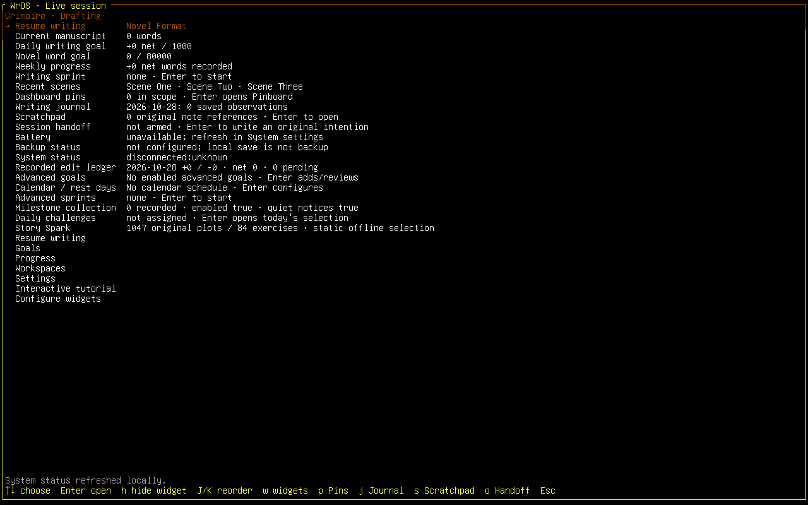

# Live WrOS session

The current live image is built with `nix build .#wros-iso` from
[nixos/modules/live.nix](../nixos/modules/live.nix). Grimoire is the actual live writing desk,
with the same theme, panels, keyboard navigation and settings as the installed
session. Its home and settings identify the live session and explain that work
must be saved somewhere persistent before restarting.

The live NixOS configuration declares `wros-live` with UID 1000. Before greetd
starts, `wros-live-session` checks `wros.live=1` and creates `session.json`,
`greetd.toml` and `greetd.env` under `/run/wros-live`. The temporary initial
session opens the writing desk; the default session remains authenticated.
The `noautologin` and `nottyautologin` aliases suppress automatic entry. The
application and locker also recognise the live medium independently.

The live configuration includes the public live account; its greetd override is
generated at runtime. The ISO also carries a separate installed-system closure
without the live account. The installer copies that closure, rather than the
live system's account configuration.

This is a public live account, not a personal authenticated session. Manual entry
uses username `wros-live` and password `wros-live-session-only`. The account is
not in `wheel`; installation uses the fixed privileged installer helper. Personal
screen locking and suspend are unavailable in the live session.

WrOS installs from the live dashboard. NixOS generates the medium's boot menu
with WrOS branding and the entry `Start WrOS <version> (try it, or install it from
the dashboard)`. The dashboard selects **Install WrOS to disk**; it and
**System › Storage** open a confirmation that defaults to staying in the live session.

Current NixOS checks are [live-session](../nixos/tests/live-session.nix) for
automatic entry and installer cancellation/handoff,
[live-graphical](../nixos/tests/live-graphical.nix) for the default graphical
session remaining alive, and [install-encrypted](../nixos/tests/install-encrypted.nix)
for installation and reboot.

**Debian media checks, rc13 and earlier.** `tools/audit-live-session.py` checks
the immutable staged profile. Unit tests
exercise account/boot selection, manual-entry options, publication ordering,
file preservation, permissions and staging leaks using private fixture files.
`live_session_uses_shared_surfaces_and_never_requests_personal_lock` exercises
the actual Grimoire controller and renderer at four terminal sizes. These
checks are not evidence of an actual live boot or physical hardware support.

## Executed local qualification (Debian builds, rc13 and earlier)

For current NixOS checks, see [NIXOS_QUALIFICATION.md](NIXOS_QUALIFICATION.md).

The [full local software run](evidence/live-session-local.json) passed 973 Rust
checks per overlapping configuration, 135 Python methods with zero skips, both
warning-denying Clippys and 21 gates. Three fresh diskless no-network guests
passed automatic entry, explicit no-auto entry and entry with the automatic
flag omitted. Each checks the actual non-root editor/input processes, native
home/Settings/power surfaces and clean shutdown. The omitted-flag case proves
the live-medium guard without a runtime marker. The separate authenticated
installed-session lock regression also passed. [Combined provenance](evidence/live-session-local-provenance.json)
retains exact source, executable and report hashes.

The development image is `build/releases/wros-live-55aa13e-development-amd64.iso`
(1,221,148,672 bytes). Its [artifact receipt](evidence/live-session-release.json)
contains the full SHA-256. The [compressed-payload audit](evidence/live-session-image.json)
retains the image build identity separately from the final test-driver identity;
all runtime sources are unchanged and stripping the tested editor reproduces
the shipped executable. The [original failed observations](evidence/live-session-attempts.json)
include the failsafe flag omission and test-driver readiness/shutdown issues.

These guests directly boot the kernel/initrd verified inside the actual ISO.
They do not qualify firmware boot, Secure Boot, physical devices or installation
from the live interface. [Debian CI 40716348352](https://github.com/j5cfk7qm49-web/WrOS/actions/runs/40716348352)
also passed 973 Rust/configuration, 135 Python/zero skips, both Clippys and all
20 CI gates. Its [artifact provenance](evidence/live-session-ci-provenance.json)
retains the actual tested merge and ZIP hash separately from local image/guest
acceptance; qualification source matches.
