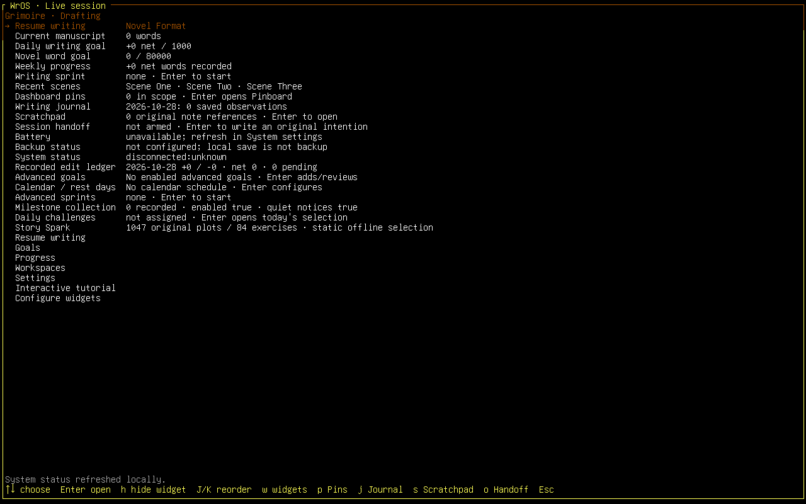

# Live WrOS session

The experimental `build-installer.sh --live` profile uses Debian live-build,
live-boot, live-config and user-setup. Grimoire is the actual live writing desk,
with the same theme, panels, keyboard navigation and settings as the installed
session. Its home and settings identify the live session and explain that work
must be saved somewhere persistent before restarting.

Debian live-config creates the temporary `wros-live` account at boot. A final
live-config component checks the explicit `boot=live wros.live=1` selection,
locked root account, reserved non-root account and read-only live medium. It
publishes a temporary greetd configuration under `/run/wros-live`. The one-time
initial session enters the normal WrOS session wrapper; greetd retains its
authenticated default session. The stock live-config getty generator is masked
so it cannot also open accounts automatically on other consoles. Documented
`noautologin` and `nottyautologin` aliases still prevent automatic entry.
Both normal and failsafe boot entries carry the live-profile flag. The session
wrapper, application and privileged lock helper also recognize the live medium
independently, so omitting the automatic-entry flag cannot turn the public
account into a personal locked session.

The immutable SquashFS contains neither the temporary account nor its runtime
configuration. `/etc/greetd/config.toml` remains the authenticated installed
configuration. The maintained live-installer copies that immutable filesystem,
rather than the running live overlay. Actual installation and reboot checks
remain necessary to qualify the complete profile.

This public live account has Debian's standard temporary live credentials and
live administration privileges. It is not a personal authenticated session.
Manual entry uses username `wros-live` and the public password `live`.
WrOS disables its personal screen-lock action in both the interface and the
privileged lock helper. Installed sessions retain the existing lock path.
Sleep remains disabled pending separate qualification.

The native installer frontend is staged for further integration. This profile
does not yet provide the privileged in-session installer supervisor. The
separate Debian Installer boot entry remains the available installation path;
the native frontend's protocol tests do not certify an installation from the
live writing desk. Matching in-session kernel/backend components and a complete
offline package pool must be integrated before that path can be enabled.

`tools/audit-live-session.py` checks the immutable staged profile. Unit tests
exercise account/boot selection, manual-entry options, publication ordering,
file preservation, permissions and staging leaks using private fixture files.
`live_session_uses_shared_surfaces_and_never_requests_personal_lock` exercises
the actual Grimoire controller and renderer at four terminal sizes. These
checks are not evidence of an actual live boot or physical hardware support.

## Executed local qualification

The [full local software run](evidence/live-session-local.json) passed 973 Rust
checks per overlapping configuration, 135 Python methods with zero skips, both
warning-denying Clippys and 21 gates. Three fresh diskless no-network guests
passed automatic entry, explicit no-auto entry and entry with the automatic
flag omitted. Each checks the actual non-root editor/input processes, native
home/Settings/power surfaces and clean shutdown. The omitted-flag case proves
the live-medium guard without a runtime marker. The separate authenticated
installed-session lock regression also passed. [Combined provenance](evidence/live-session-local-provenance.json)
retains exact source, executable and report hashes.

The development image is `build/releases/wros-live-55aa13e-development-amd64.iso`
(1,221,148,672 bytes). Its [artifact receipt](evidence/live-session-release.json)
contains the full SHA-256. The [compressed-payload audit](evidence/live-session-image.json)
retains the image build identity separately from the final test-driver identity;
all runtime sources are unchanged and stripping the tested editor reproduces
the shipped executable. The [original failed observations](evidence/live-session-attempts.json)
include the failsafe flag omission and test-driver readiness/shutdown issues.

These guests directly boot the kernel/initrd verified inside the actual ISO.
They do not qualify firmware boot, Secure Boot, physical devices or installation
from the live interface. [Debian CI 40716348352](https://github.com/j5cfk7qm49-web/WrOS/actions/runs/40716348352)
also passed 973 Rust/configuration, 135 Python/zero skips, both Clippys and all
20 CI gates. Its [artifact provenance](evidence/live-session-ci-provenance.json)
retains the actual tested merge and ZIP hash separately from local image/guest
acceptance; qualification source matches.
